# DCC diagrams

Mermaid renders directly on GitHub. Diagrams marked **(planned)** show the intended design of parts that are not built yet.

## 1. System context

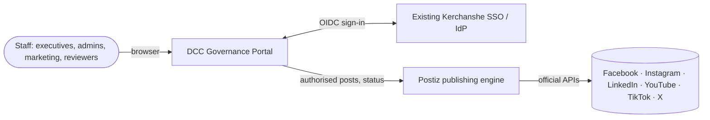

## 2. Containers

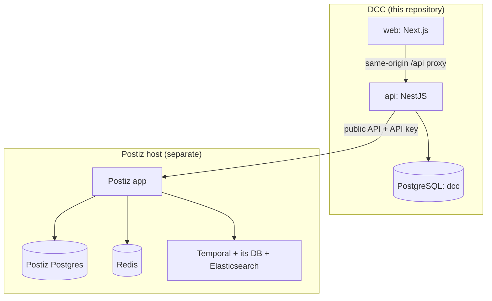

## 3. API components

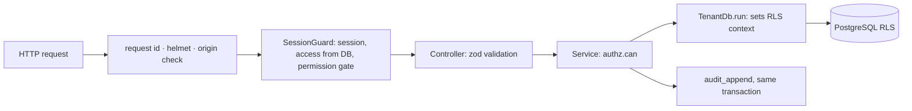

## 4. Tenancy model

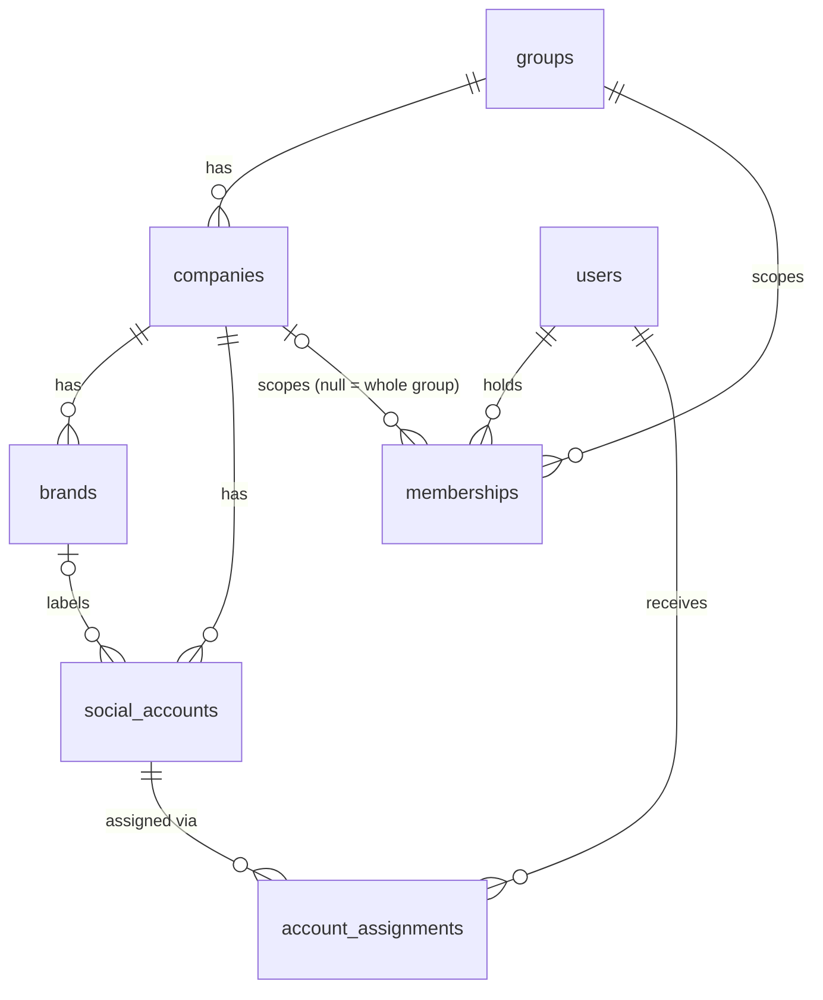

Every company-scoped table carries `company_id` and an RLS policy; see [TENANCY-AND-RLS](../security/TENANCY-AND-RLS.md).

## 5. Sign-in (implemented, verified against the dev SSO)

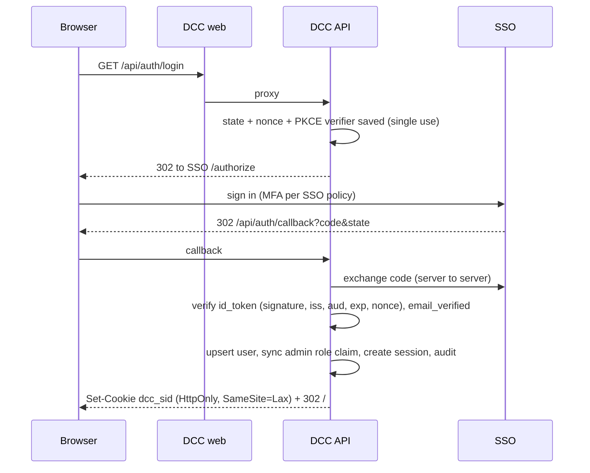

## 6. Authorization and isolation

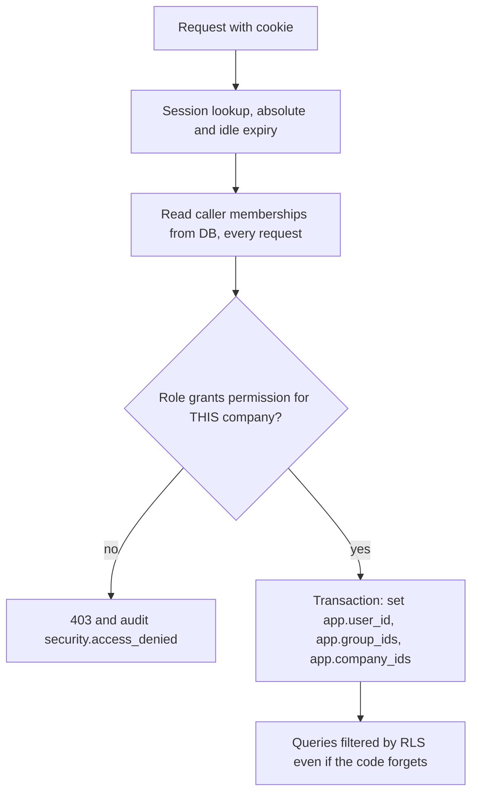

## 7. Content approval and publishing (planned; gate implemented)

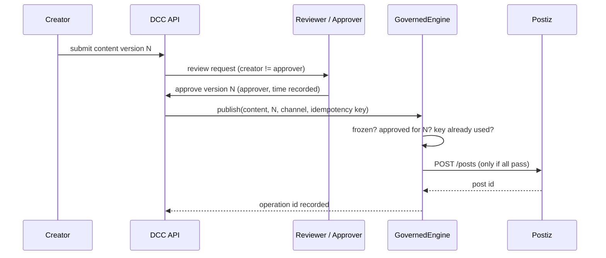

## 8. Postiz integration and status (planned)

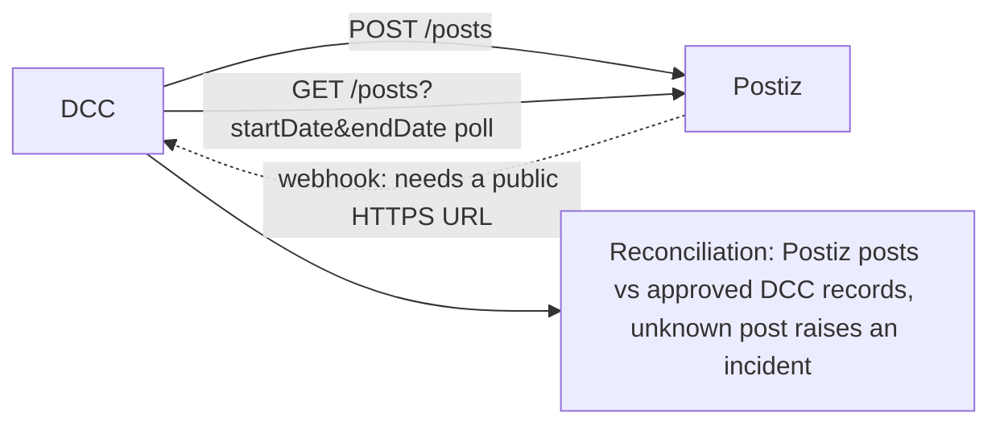

Postiz webhooks must target a public HTTPS address and refuse internal ones, so polling is the baseline and the webhook an option. See [POSTIZ-INTEGRATION](../engine/POSTIZ-INTEGRATION.md).

## 9. Social account authorisation (planned)

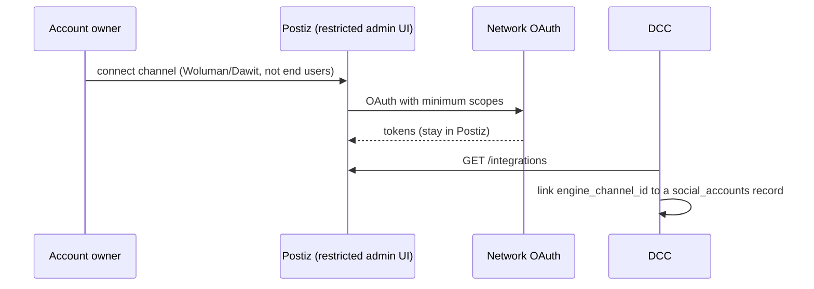

DCC never stores social tokens.

## 10. Incident response (planned)

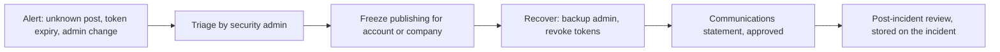

## 11. Environments

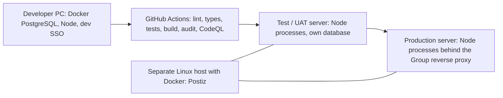
