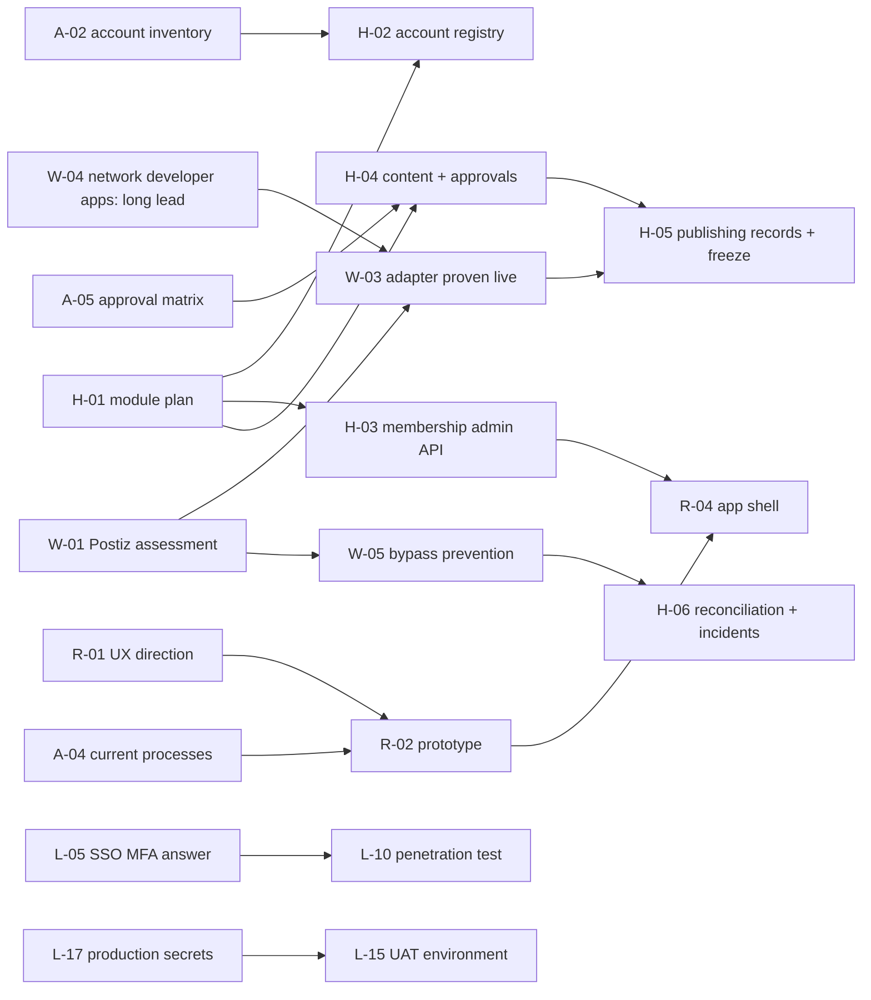

# Dependency map

Critical path to the pilot: **A-05 → H-04 → H-05 ← W-03 ← W-04** (the network developer-app approvals are the longest and least controllable item: start W-04 first),
and **R-01 → R-02 → R-04**. Decisions D-03, D-04, D-05 gate the first server deployment.
